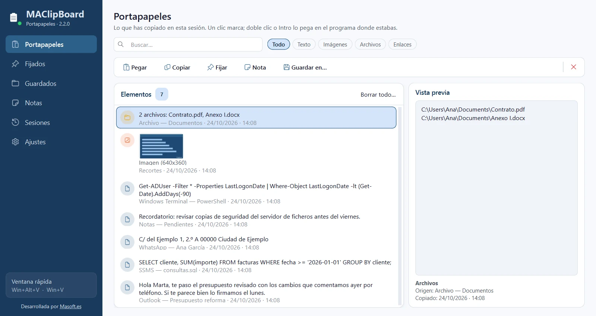
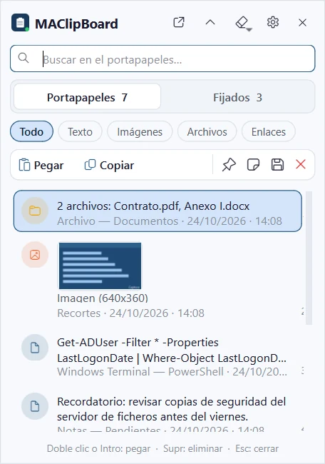
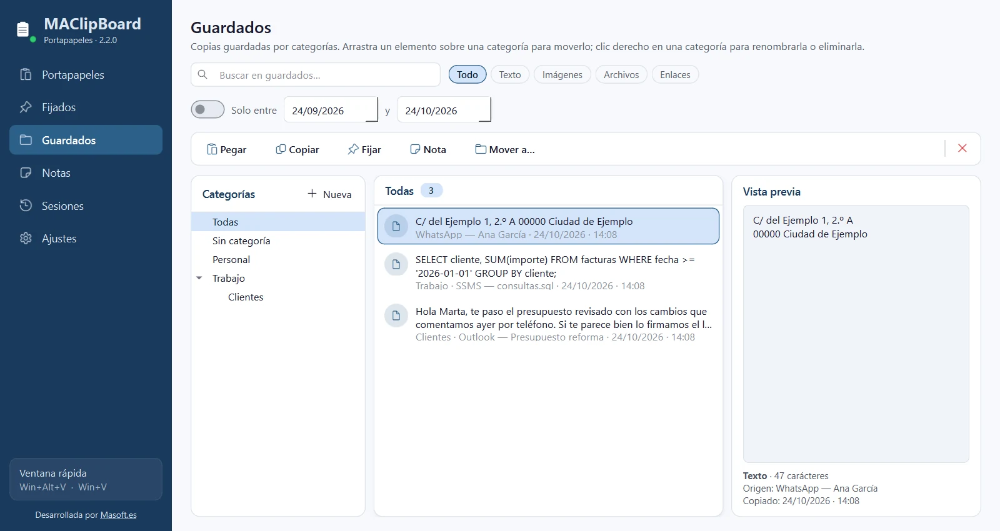
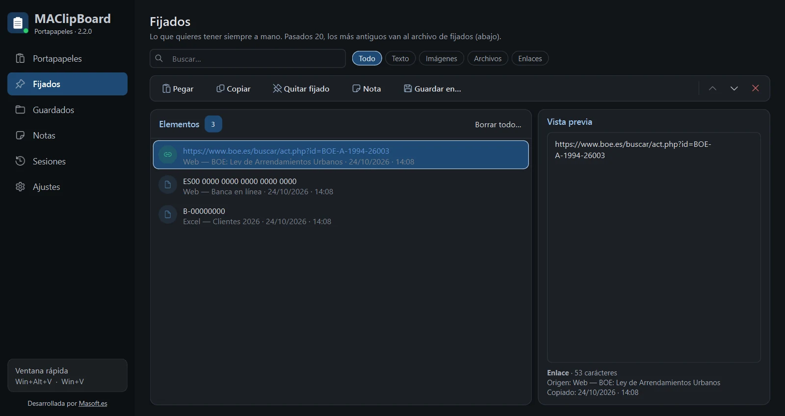

# MAClipBoard

Sustituto avanzado del historial del portapapeles de Windows (Win+V): doble clic y queda pegado donde estabas escribiendo. Guarda texto, imágenes y archivos que copias, con fijados reordenables, guardados por categorías, notas en el escritorio y sesiones anteriores.

**Software gratuito desarrollado por [Masoft.es](https://masoft.es)**

[](https://github.com/MaSoft/MAClipBoard/releases/latest)

También puedes descargarlo desde [masoft.es](https://masoft.es/descargas.html).



## Características
- Pega donde estabas: doble clic, Intro o Alt+1…9 vuelve al programa en el que escribías y lo pega en el campo.
- Guarda al instante el texto, las imágenes y los archivos que copias, con el programa de origen y la hora.
- Busca y filtra por Texto, Imágenes, Archivos o Enlaces con un clic.
- Fijados reordenables para lo que usas a menudo, siempre a mano y en tu orden.
- Guardados por categorías y subcategorías (hasta 3 niveles); arrastra para reorganizar.
- Notas flotantes en el escritorio a partir de cualquier copia, con color.
- Recupera lo que tenías copiado en una sesión anterior.
- Lo que un gestor de contraseñas marca como privado nunca se guarda. Tema claro y oscuro.

## Capturas

| | |
|---|---|
| <br>**Ventana rápida.** Se abre con el atajo junto a donde escribes: doble clic o Intro y queda pegado. | <br>**Guardados.** Copias permanentes en categorías y subcategorías, con búsqueda y filtro por fechas. |
| <br>**Tema oscuro.** Los fijados en tema oscuro; se cambia al momento desde Ajustes. |  |

## Requisitos

| | |
|---|---|
| Sistema | Windows 10 o Windows 11 de 64 bits |
| Permisos | Usuario normal: no necesita administrador |
| Instalación | No hace falta: un solo .exe que se copia y se abre. Tarda unos segundos más en arrancar porque se descomprime en la carpeta temporal |
| Espacio | 37 MB el programa, más lo que ocupen las imágenes copiadas |
| Internet | No la necesita: todo se queda en el equipo |

Crea su carpeta data junto al .exe, donde guarda el historial y los ajustes. Funciona desde la bandeja del sistema.

## Descarga y comprobación

En [Releases](https://github.com/MaSoft/MAClipBoard/releases/latest) están el programa (`MAClipBoard_v2.2.0.exe`), su huella SHA-256 y el manual. Para comprobar que la descarga está completa, en PowerShell:

```powershell
Get-FileHash .\MAClipBoard_v2.2.0.exe
```

Debe coincidir con `533a1850e161ac88f80251f90945034c30e587f339c40313fe2b393362faa484`.

## Manual

[manual_MAClipBoard.html](https://github.com/MaSoft/MAClipBoard/releases/latest/download/manual_MAClipBoard.html): descárgalo y ábrelo en el navegador.

## Aviso legal

MAClipBoard es gratuito y se entrega tal cual, sin garantía de ningún tipo. Al descargarlo y usarlo aceptas el aviso legal y las limitaciones de su manual.

> MAClipBoard accede al contenido del portapapeles, a la ventana en primer plano en el momento de cada copia (para anotar el origen) y, al pegar, al elemento con el foco del programa donde estabas (solo para saber si es un campo de texto; no lee su contenido). El historial, las imágenes y las sesiones se guardan únicamente en el equipo, en la carpeta data\ de la propia aplicación (copiar o borrar esa carpeta copia o borra los datos con ella) — nada se envía a ningún servidor externo.

**Limitaciones conocidas**

Lo que los gestores de contraseñas y algunos formularios bancarios marcan como excluido del historial no se captura, por diseño. La detección del campo de texto depende de lo que informa cada programa: en algunos puede no detectarse (queda copiado) y, con Pegar siempre, se envía Ctrl+V aunque no haya campo. La detección del origen es aproximada. El usuario es responsable de revisar qué guarda de forma permanente, sobre todo si el equipo lo comparten varias personas.

Este repositorio solo contiene el programa compilado y su documentación. © Masoft.es. Todos los derechos reservados.
